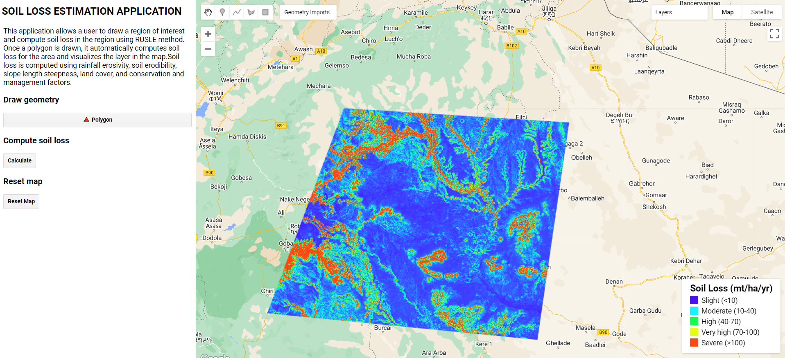

**A first-pass soil loss estimate for any area: draw a boundary and get an erosion map in minutes, with no GIS software or data downloads.**

Soil erosion assessments usually need a GIS analyst to assemble five separate datasets before any planning conversation can start. This app turns my [RUSLE workflow from Somalia](../projects/soil_loss_assessment) into a self-service tool. It computes rainfall erosivity, soil erodibility, slope length-steepness, cover management and support-practice factors on the fly. It returns annual soil loss in t/ha/yr for any region the user selects. Land managers and project designers can use it to screen where to target soil and water conservation before investing in field surveys.

Link to [App](https://ee-kimeu.projects.earthengine.app/view/soil-erosion-estimation)
