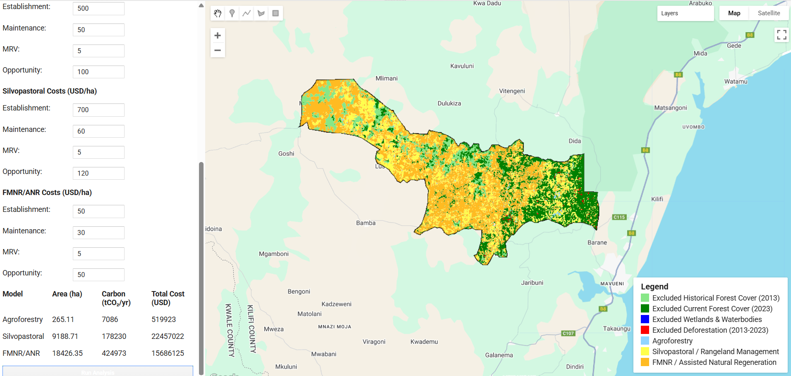

**Used by 13 implementing partners in Kenya (3), Malawi (3) and Uganda (7) to decide where restoration should happen.**

Restore Africa is one of the largest community-led land restoration programmes in the world. It aims to restore 1.9 million hectares across six countries: Uganda, Kenya, Ethiopia, Malawi, Tanzania and Zambia. At that scale, partners need a consistent, defensible way to decide which land is eligible, and what each intervention could return, before committing field teams and carbon finance.

I built this Earth Engine decision support tool for CIFOR-ICRAF to answer that question. For any area of interest, partners can:

- **Screen site eligibility** for agroforestry, silvopastoral management and farmer-managed natural regeneration (FMNR), using land cover, conservation zones and recent deforestation trends
- **Estimate implementable area** for each intervention
- **Project carbon mitigation potential** and the **net present value** of implementation costs

Partners in all three countries now screen sites with one shared method, replacing ad hoc local judgement. This gives a common evidence base for planning, stakeholder engagement and investment decisions.

Link to [Earth Engine App](https://kimeu.users.earthengine.app/view/resaf-decision-support-tool)
