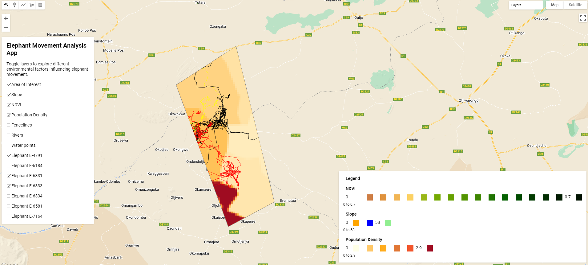

**The interactive companion to the [EHRA corridor analysis](../projects/elephant-movement), and the map layer that EHRA, farmers, conservancies and the Ministry used to plan coexistence measures.**

The app lets non-specialists explore what drives desert-adapted elephant movement across Kunene and Erongo. It combines 10 GPS collars (27,167 hourly fixes) with Airbus Pléiades Neo land cover, vegetation health, slope, water points, population density and fencelines. EHRA used these layers in community and farmer workshops. There, stakeholders validated conflict hotspots and agreed which mitigation projects to prioritise. That work led to a farm-level "elephant corner" and fed into wildlife corridor planning.

Link to [App](https://kimeu.users.earthengine.app/view/elephant-movement)
