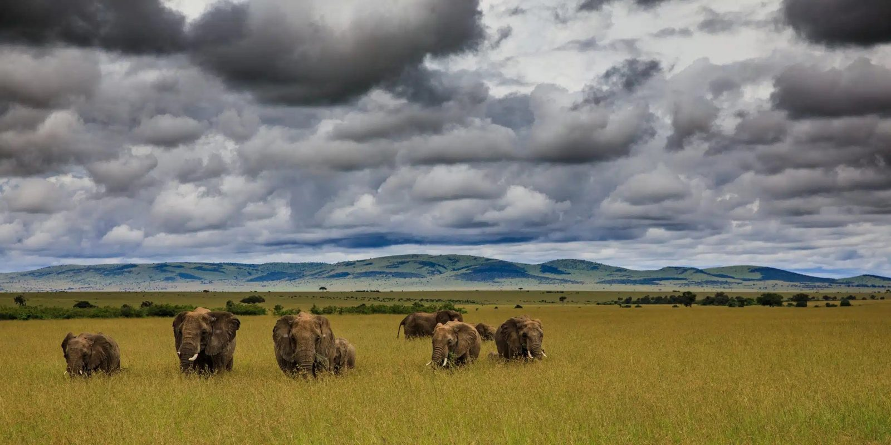

**The evidence the Mara Elephant Project (MEP) will use to decide where to extend its geofence early-warning system, and which corridors to confirm with communities on the ground.**

Human–elephant conflict in the Maasai Mara has risen since 2021 as farms and settlements spread into elephant range. MEP needed to know which movement routes elephants still depend on, and where conflict is concentrating, so it could put limited ranger and community resources in the right places.

The StoryMap shows which corridors elephants still rely on and where conflict is concentrating. It is built from GPS collar data for three elephants, 239 recorded conflict incidents, Random Forest land cover classification of Airbus Pléiades imagery, Circuitscape corridor modelling and a Combined Pressure Index. The StoryMap presents the results for conservation practitioners, donors and policymakers.

**How MEP will use it:**
- **Participatory mapping:** MEP will take the corridor and hotspot maps to local communities, so residents can confirm and refine them from their own experience of living alongside elephants.
- **Geofence extension:** The results will guide where MEP extends its geofence, the virtual boundary that alerts rangers and communities when collared elephants approach farms and settlements. The extension targets the areas where conflict has increased most since 2021.

The goal: reduce conflict while keeping the Mara's key elephant movement routes open.

Link to [StoryMap](https://storymaps.arcgis.com/stories/32f4a57fcf084922b0f5654df26c6a6a)

Cover photo: © Mara Elephant Project

