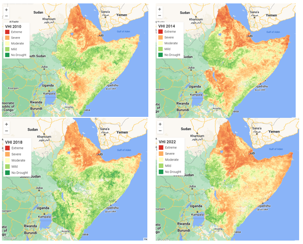
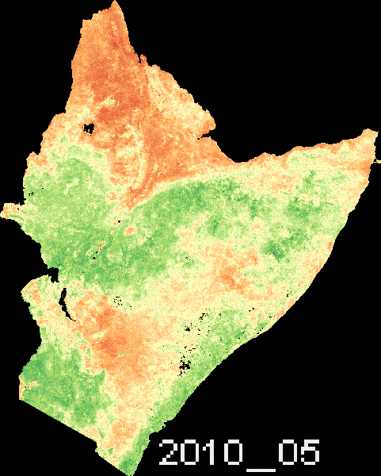
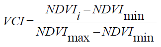
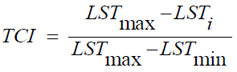

## What it shows
**2022 was a regional drought, not a local one.** Vegetation health during the March–June long rains fell to severe or extreme levels across almost the entire Horn of Africa. The worst and most prolonged conditions were in Eritrea, Djibouti, Somalia, Ethiopia and north-eastern Kenya.

Repeated failed rains have left millions of people and livestock in the region facing hunger and water shortages. Responders need more than "it is dry". They need to know where it is worst and how this season compares with others, so food, water and livestock support goes to the right places first. These maps answer both questions. Because they are built from free satellite data, they can be refreshed every season to give early-warning teams a consistent signal to act on.

## How it works
The Vegetation Health Index (VHI) for every long-rains season from 2010 to 2022, computed in Google Earth Engine from MODIS NDVI and land surface temperature. VHI combines how green vegetation is (Vegetation Condition Index) with how much heat stress it is under (Temperature Condition Index), each relative to its own historical range.

  
  
  

Source: <a href="https://github.com/japhethkimeu/droughtmonitoring"><i class="large github icon"></i>droughtmonitoring</a>
