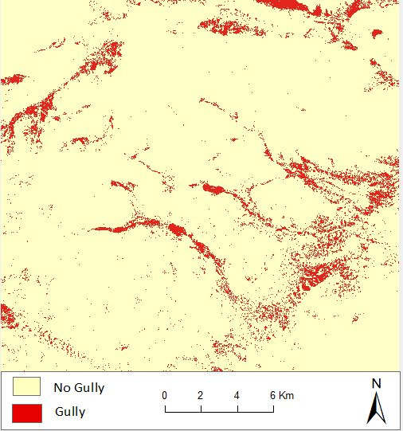

## What it delivers
**A map of where land is being torn apart by gully erosion, made from satellite imagery instead of field surveys.**

About two-thirds of Africa's productive land is degraded (UNCCD 2013). Water erosion accounts for 46% of land degradation in sub-Saharan Africa (Jones et al. 2013). Gullies are its most severe form: they strip away huge volumes of soil and cut farmland out of production (Daba, Rieger and Strauss 2003). Restoration and soil conservation programmes need to know where gullies are before they can target check dams, revegetation or land-use changes. Finding them on foot is slow and doesn't scale.

This project shows that freely available Sentinel-2 imagery and machine learning can do that job. It produces gully maps at landscape scale that programmes can use to target restoration investment and report progress toward land degradation neutrality.

## How it works
Sentinel-2 imagery, atmospherically corrected with Sen2Cor, classified into gully and no-gully using Random Forest and Support Vector Machines. Both models were trained and validated on digitised reference samples.

Source: <a href="https://github.com/japhethkimeu/gully_feature_mapping"><i class="large github icon"></i>gully_feature_mapping</a>
