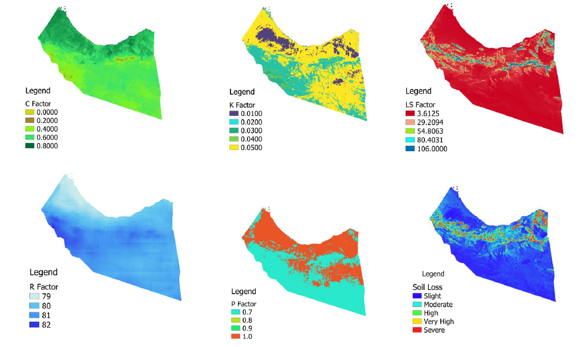

  
 

## What it shows
**North-Western Somalia loses an average of 36 tonnes of soil per hectare every year.** The losses are far from evenly spread: they concentrate on the steep mountainous and hilly terrain, where rainfall washes topsoil off exposed slopes.

That gives land managers a clear starting point. Soil and water conservation works best on the slopes that are losing the most. The map shows where those slopes are, which supports land degradation neutrality targets and natural resource planning in a region where field data is scarce.

The analysis didn't stop at one region. I turned it into a public [Soil Erosion Risk Estimation app](https://ee-kimeu.projects.earthengine.app/view/soil-erosion-estimation) that anyone can run for their own area.

## How it works
The Revised Universal Soil Loss Equation (RUSLE; Renard et al. 1996), **A = R × K × LS × C × P**, implemented in Google Earth Engine. It combines rainfall erosivity, soil erodibility, slope length-steepness, cover management and support practice into annual soil loss in t/ha/yr. More about RUSLE: https://handle.nal.usda.gov/10113/11126.

Source: <a href="https://github.com/japhethkimeu/soil_loss_assessment"><i class="large github icon "></i>soil_loss_assessment</a>
