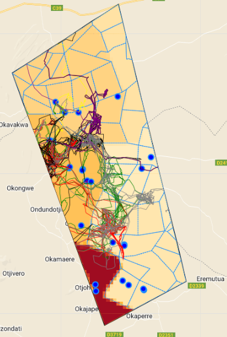

## Impact at a glance
- **From analysis to agreement:** EHRA took the movement and conflict maps into community workshops and joint meetings with commercial farmers and the Ministry of Environment, Forestry and Tourism (MEFT). There, farmers validated conflict hotspots, water points and fences through participatory mapping.
- **Fairer prioritisation:** Communal farmers, conservancies and traditional authorities used the maps to agree which mitigation projects to fund first.
- **Land set aside for elephants:** On Otjongoro Farm, the collar and satellite data showed heavy use of a natural spring. The farmer agreed to give that area over to elephants in exchange for protection of the rest of the farm. EHRA fenced off an "elephant corner", and the elephants have started using it.
- **Foundation for corridor design:** The outputs underpin EHRA's wildlife corridor planning, its EarthRanger live-tracking platform for farmers, and its Ethical Elephant Tourism campaign.

Read the full case study: [Using satellite imagery to build the foundation of elephant corridors in Namibia](https://connectedconservation.foundation/ecosystem-insights-hub/using-satellite-imagery-to-build-foundation-of-elephant-corridors-in-namibia/) (Connected Conservation Foundation).

## The problem
In Namibia's Kunene and Erongo regions, desert-adapted elephants range into commercial farmland in search of water and forage. They break fences and damage crops and infrastructure, and some farmers respond with lethal measures. Elephant-Human Relations Aid (EHRA) needed evidence of *why* elephants move where they do, so it could design a corridor that both farmers and elephants could live with.

EHRA was a winner of the 2023 Satellites for Biodiversity Awards, run by the Connected Conservation Foundation with the Airbus Foundation. Through the award, I provided the geospatial and Earth observation analysis.

## What the data showed
- **Water drives movement.** Between January and April 2024, elephants returned repeatedly to specific water points, including man-made ones.
- **Vegetation pulls them along rivers.** NDVI showed a strong preference for healthy vegetation, especially along river channels.
- **Terrain constrains them.** 90% of movements occurred on gentle slopes. Elephants avoided steep ground, densely populated areas and deep river sections.
- **Fences redirect but don't stop them.** Elephants followed fence lines when blocked but sometimes breached commercial farms by damaging fences. These are exactly the points where conflict occurs.

## How it works
30 cm Airbus Pléiades Neo imagery (about 73 × 32 km), classified into land cover and habitat maps in Google Earth Engine. These were combined with 10 GPS collars (27,167 hourly fixes, January–April 2024) and layers for slope, NDVI, rivers, fencelines, population density and water points to test what drives elephant movement.

## What's next
EHRA plans to extend the analysis into the wet season with annual data for corridor planning. It also plans to develop a machine-learning tool to detect man-made water points across a wider area.

Explore the data: [Elephant Movement app](https://kimeu.users.earthengine.app/view/elephant-movement)

Source: <a href="https://github.com/japhethkimeu/elephant-movement"><i class="large github icon"></i>elephant-movement</a>
