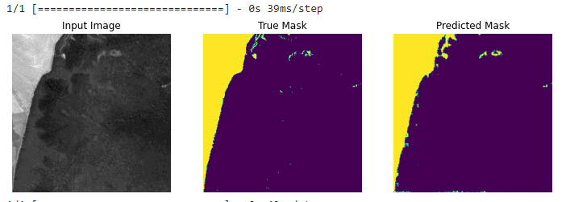
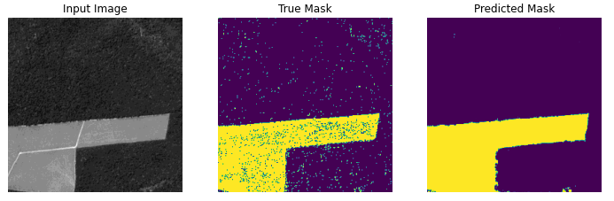
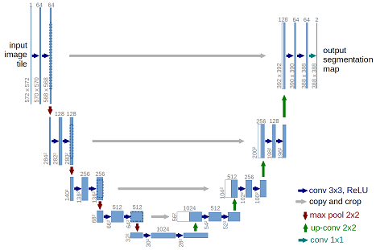

## What it delivers
**Forest loss, mapped automatically, 91% of the time correctly.** Given a Sentinel-2 scene, the model outlines where forest has been cleared, with no analyst drawing the boundaries. On imagery it had never seen, it got 91.2% of pixels right.

Brazil has lost over 500,000 km² of natural vegetation in 50 years, much of it on the Mato Grosso frontier. Satellites already pass every few days. What slows down monitoring is turning those images into maps someone can act on. A model like this closes that gap. Forest agencies, REDD+ projects and carbon programmes get a forest loss map every time new imagery arrives, so they can respond to clearing while it is still happening instead of documenting it months later.

## How it works
A U-Net deep learning model with a MobileNetV2 encoder, trained on 5,122 labelled Sentinel-2 image chips (256 × 256 px) from three regions of Mato Grosso, built in TensorFlow/Keras. Fine-tuning the full network reached 97.8% accuracy in training and 91.2% on held-out data. Better-quality training masks are the clearest route to pushing accuracy higher.

More on U-Net: [U-Net: Convolutional Networks for Biomedical Image Segmentation](https://lmb.informatik.uni-freiburg.de/people/ronneber/u-net/)

Source: <a href="https://github.com/japhethkimeu/deep_learning"><i class="large github icon"></i>deforestation</a>
