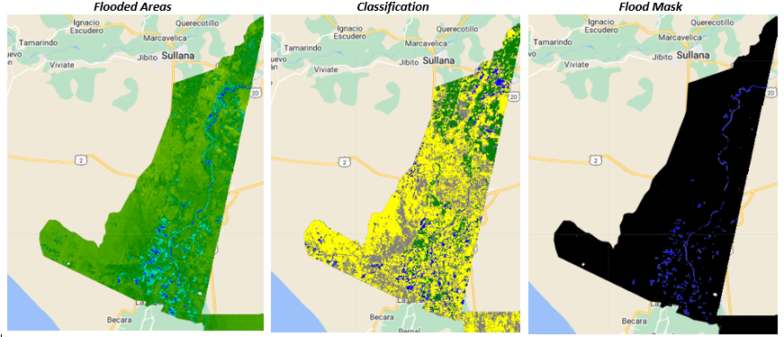

## What it shows
**The March 2021 floods in Piura Province, Peru, put more than 16,000 people's homes under water and drowned over 877 hectares of cropland.** Farmland was the hardest-hit land use.

El Niño-like rains that month damaged more than 3,000 homes and killed dozens of people across several Peruvian provinces. In the first days after a disaster, responders can't wait for field teams to tell them who is affected and where. This assessment gives those answers from satellite imagery alone: the flood footprint, the people inside it, and the crops lost. Relief, recovery and agricultural support can then go where the damage actually is. The same approach works for any flood with clear-sky imagery.

 

## How it works
Before-and-after Sentinel-2 imagery compared in Google Earth Engine. A Modified Normalised Difference Water Index (MNDWI) flood mask is overlaid on the Global Human Settlement Layer to count affected people, and on MODIS/ESA land cover to measure affected cropland.

Source: <a href="https://github.com/japhethkimeu/flood_analysis"><i class="large github icon"></i>flood analysis</a>
