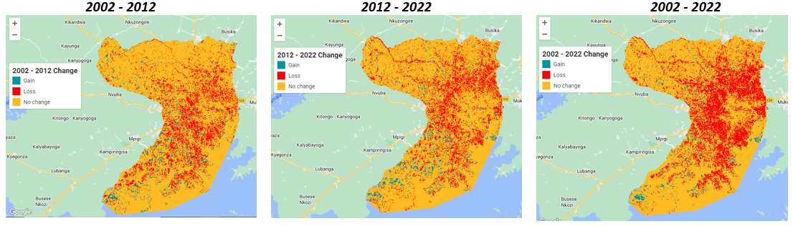
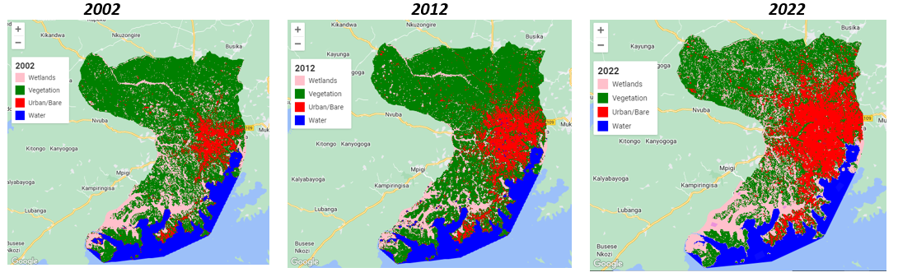

## What it shows
**Kampala's growth has swallowed more than 14,000 hectares of Lake Victoria wetlands in two decades.** Between 2002 and 2022, wetlands were converted to urban land and cropland. The loss accelerated sharply after 2012, as the city expanded under population pressure. In the same decade the city also absorbed much of the surrounding cropland.

These wetlands supply food and water, shelter rich bird and animal life, buffer floods and purify water. Uganda is trying to protect and restore them through policy enforcement and stakeholder engagement, but regulators can't act on loss they can't see. These maps show where wetlands have disappeared and how fast, so enforcement and restoration can be aimed at the places under most pressure. Because the method uses the free Landsat archive, it can be repeated to check whether protection is working.

## How it works
Cloud-free Landsat median composites for three periods (1999–2002, 2009–2012, 2019–2022), enriched with NDVI, NDWI and EVI and classified into land cover in Google Earth Engine. The three maps were then compared to measure the area of each type of change.

Source: <a href="https://github.com/japhethkimeu/wetlands-change-detection"><i class="large github icon"></i>Wetlands change detection</a>
