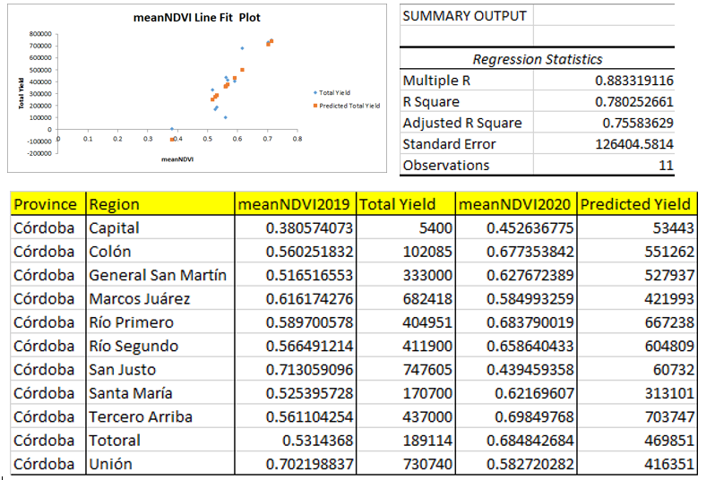
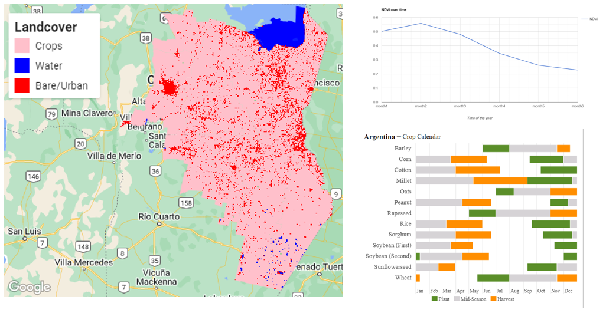

## What it shows
**Satellites can estimate how much was planted and how well it will yield, close enough to official statistics to be useful.** In Córdoba, Argentina, planted area for soybean, maize, millet and peanut came within 18% of Ministry of Agriculture figures for the 2019/20 season. A single satellite measure of crop vigour explained 75% of the variation in yield between regions.

Governments plan food security, trade and input support around crop statistics. Those statistics still depend on field officers travelling farm to farm and extrapolating from samples, which is slow, costly and often too coarse to rely on. A satellite estimate covers every field and can be produced during the season, giving planners an earlier and fuller picture. Adding soil, rainfall and temperature data would tighten the estimates further.

## How it works
Sentinel-2 imagery from the January–March 2020 peak-greenness window, when crop NDVI is highest, classified to measure planted area. Mean NDVI per region was regressed against [Ministry of Agriculture, Livestock and Fisheries](https://datos.magyp.gob.ar/dataset) yield data (R² = 0.78, adjusted R² = 0.75), and the model was used to predict the following season's yield.

Code: <a href="https://github.com/japhethkimeu/crop-production"><i class="large github icon"></i>Crop production</a>
